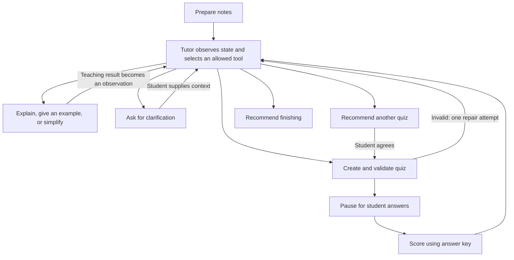

# StudyBuddy

A small adaptive learning assistant built with **Python, LangGraph, Streamlit, and GPT-OSS 20B served by Groq**. The tutor selects teaching tools from observed performance, explains missed concepts with fresh examples and extra background, and chooses the next useful practice activity. The original local Qwen 2.5 7B Instruct setup remains available through explicit server configuration.

Repository: [shanvsrivas/Flexi-AgenticAI](https://github.com/shanvsrivas/Flexi-AgenticAI).

Public prototype: [Open StudyBuddy](https://flexi-agenticai-v5z2sxuprwkupywyvkepc9.streamlit.app/).

## Run on this computer

Dependencies have been installed in the project-local `.venv`.

```powershell
cd E:\AgenticAI
.\run.ps1
```

Open **http://127.0.0.1:8501**. If PowerShell's execution policy blocks the script, use this equivalent command:

```powershell
.\.venv\Scripts\python.exe -m streamlit run frontend/app.py --server.headless true
```

For a fresh Python 3.12 installation, run `setup.ps1` first. Alternatively:

```powershell
python -m venv .venv
python -m pip --python .venv\Scripts\python.exe install -r requirements-dev.txt
```

On another computer, clone the repository and run these commands from its root folder. Original course certificates and classroom requirement screenshots are retained in the local submission copy and excluded from Git.

## Connect the tutor

The default provider is **Groq**, using `openai/gpt-oss-20b`. Copy
`.streamlit/secrets.toml.example` to `.streamlit/secrets.toml` and replace the
placeholder with your private Groq API key. Streamlit reads this file locally;
on Community Cloud, enter the same settings in the app's **Secrets** settings.
Never commit the real key. End users do not need their own API key.

Groq runs inference on its servers, so the hosted app works while your laptop is
off. Its free plan has shared request/token limits; this is intended for a small
demonstration, not unlimited simultaneous use. A limit error does not switch to
another model or to the fixed example session. Notes and answers used for live
tutoring are sent to Groq.

For the original local setup, explicitly set `STUDYBUDDY_PROVIDER = "lmstudio"`
in Streamlit secrets or the process environment:

1. Load **Qwen 2.5 7B Instruct** with model ID `qwen2.5-7b-instruct`.
2. Start the API server in LM Studio's **Developer** tab.
3. StudyBuddy connects automatically to `http://localhost:1234/v1`; users do not configure a connection or choose a model.
4. Paste notes, or click **Load example notes**, then **Start learning**.

The optional LM Studio adapter uses Qwen locally with the fixed identifier
`qwen2.5-7b-instruct`. Groq uses the fixed identifier `openai/gpt-oss-20b`.
There is no model picker or automatic provider fallback.

Server-side settings: `STUDYBUDDY_PROVIDER` (default `groq`), `GROQ_API_KEY`,
and optionally `LMSTUDIO_BASE_URL`, `LMSTUDIO_API_KEY`, `LMSTUDIO_TIMEOUT`
(30–600 seconds; default 180). See `.streamlit/secrets.toml.example`. The app reads Streamlit
secrets or environment variables; it does not automatically load `.env` files.
Credentials stay on the server and are excluded from exports. There is no
user-facing connection panel.

## What is implemented

- Notes between 100 and 10,000 characters, with at least 20 words.
- Three to five multiple-choice questions per round.
- A tutoring agent that observes notes, answers, scores, and tool results, then chooses an allowed tool and its arguments.
- Six actions: create a quiz, explain a concept, give a worked example, simplify a concept, ask for clarification, or recommend finishing.
- Generated concept teaching after mistakes: a possible misconception, a fresh explanation, a concrete example, extra insight, and a self-check question. Original source text is a collapsed reference, not the main feedback.
- Pydantic validation, unique self-contained options, source IDs, source-text integrity checks, and one repair attempt for invalid output. The model selects a source ID; the app copies the original source section as evidence.
- Actual LangGraph human-input interrupts, checkpointing, and `Command(resume=...)`.
- Deterministic scoring against the generated answer key.
- Model-selected teaching strategy, quiz difficulty, and recall/application question style. The agent can offer a challenge after reaching the score goal or recommend stopping below it without inventing a passing result.
- Code-enforced limits: feedback for every missed concept, at most three quizzes, two clarifications, 24 agent decisions, and bounded output-repair attempts.
- Answer review, progress history, and a downloadable study summary. Technical traces and full Markdown/JSON evidence remain available through the live verification script and saved artifacts.
- Short free-tier rate limits are retried with a bounded wait. If a request still stops, **Try tutor again** resumes the saved session without grading answers twice or discarding progress.
- A clearly labelled sample mode with fixed authored notes/questions. It runs the same graph without calling an LLM and does not accept arbitrary notes.

The interface focuses on learning, with connection settings and graph internals kept out of the study screens. Use **Try an example** to explore a preset lesson without connecting a model; this is fixed demonstration content rather than a second inference model.

## Architecture



There is **one tutoring agent**. The model returns a structured tool selection, arguments, and a short action justification. LangGraph validates that selection, dispatches the tool, records its result, and returns control to the model. This is model-directed action selection rather than a fixed score-to-revision route. The protocol uses schema-constrained JSON rather than the provider's native `tool_calls` format. Scoring and policy checks remain deterministic. There is no vector database or web search.

Extra explanations can include established model knowledge beyond the supplied notes. The interface labels that background separately; it is not presented as a verified source quotation. Assessment questions remain restricted to the notes. Additional explanations can still contain errors and require review.

## Verify

```powershell
.\.venv\Scripts\python.exe -m pytest -q --junitxml=artifacts/test-results/test-results.xml
.\.venv\Scripts\python.exe scripts/live_smoke.py
```

Tests cover model-selected tools at the same score, adaptive difficulty, completion choices, clarification, generated teaching, policy enforcement, scoring, isolation, bounded retries, exports, Groq protocol/error handling, and a complete interface session. The live smoke test calls the configured model and saves its actual decisions and teaching under `artifacts/live-verification/`. Existing Qwen evidence records the original local implementation; it does not prove Groq inference. Scripted answers exercise the workflow; its scores are software verification, not evidence of learning improvement.

## Project files

```text
AgenticAI/
├── frontend/                 # Streamlit screen and CSS
│   ├── app.py
│   └── assets/styles.css
├── backend/                  # Agent, graph, model client, and tools
│   └── studybuddy/
├── tests/                    # Checks grouped by application layer
│   ├── frontend/
│   └── backend/
├── docs/                     # Submission report and explanation guides
│   ├── certificates/         # Your two supplied course certificates
│   ├── requirements/         # Supplied submission form and marking rubric
│   └── diagrams/             # LangGraph workflow diagram source
├── artifacts/                # Recorded evidence
│   ├── test-results/
│   ├── live-verification/
│   └── screenshots/
├── examples/                 # Study notes for a demonstration
├── scripts/                  # Live-model verification utility
├── .streamlit/               # Shared Streamlit theme/server configuration
├── requirements.txt
├── requirements-dev.txt
├── pytest.ini
├── run.ps1                   # Start from the project root
├── setup.ps1                 # Install dependencies
└── README.md
```

See [the full layout guide](docs/project-structure.md) for how these folders map to the submission requirements. The frontend and backend remain Python layers of the same application; start both with `run.ps1`.

For the viva, [the agent workflow guide](docs/agent-workflow.md) explains precisely which decisions Qwen makes and which limits Python enforces.

| File | Purpose |
|---|---|
| `frontend/app.py` | Streamlit interface |
| `frontend/assets/styles.css` | Interface styling |
| `backend/studybuddy/graph.py` | LangGraph nodes, state, conditional routes, interrupts |
| `backend/studybuddy/agent.py` | Tool catalogue, decision context, and executable-action rules |
| `backend/studybuddy/llm.py` | Groq/local API adapters and tutoring prompts |
| `backend/studybuddy/models.py` | Generated lesson/question schemas |
| `backend/studybuddy/tools.py` | Source preparation, retrieval, validation, scoring |
| `backend/studybuddy/sample.py` | Labelled offline fixtures |
| `backend/studybuddy/export.py` | Report and evidence downloads |
| `tests/` | Automated checks |
| `docs/report-draft.md` | Submission draft, aligned to the supplied form |
| `docs/demo-and-viva.md` | Demonstration script and explanation guide |
| `docs/testing-evidence.md` | Test matrix and evidence locations |

## Practical limits

- Model-generated questions, explanations, and answer keys can be wrong. Exact quote matching verifies that a quote occurs in notes, not that it logically proves the answer. Review the output before presenting it.
- Retrieval is a small lexical search, not embedding-based RAG. All notes are used initially; relevant sections are prioritised for revision.
- The score goal guides the tutor and determines whether a completed session reached its target; it is not a validated mastery measure. With three questions, an 80% goal requires all three correct. The model can recommend further practice or stopping, within the fixed session limits.
- Checkpoints are stored in memory. Restarting the app loses them; browser reloads may start a new Streamlit session. Download evidence to retain it.
- Exact and closely reworded questions are rejected in live mode using text similarity, but semantically similar questions can still occur. Sample follow-ups use a second fixed question bank and may repeat in round three.
- Local generation speed depends on your hardware, quantisation, and model context settings. Start with three questions if the 7B model is slow.
- Community Cloud can sleep when inactive, and Groq free-tier limits are shared across visitors. The URL remains usable while the app/account is retained, subject to provider availability. Ongoing sessions are lost on restarts.

For the container, runtime settings, and checks needed to publish the existing
application, see [the cloud deployment guide](deploy/README.md).

## References

- [LangGraph state and graph API](https://docs.langchain.com/oss/python/langgraph/graph-api)
- [LangGraph interrupts and checkpointing](https://docs.langchain.com/oss/python/langgraph/interrupts)
- [LM Studio local server](https://lmstudio.ai/docs/developer/core/server)
- [LM Studio structured output](https://lmstudio.ai/docs/developer/openai-compat/structured-output)
- [Groq structured output](https://console.groq.com/docs/structured-outputs)
- [Groq rate limits](https://console.groq.com/docs/rate-limits)

The implementation was created for this project with AI coding assistance. These documentation references informed its API usage; no external application repository was copied into this project.
